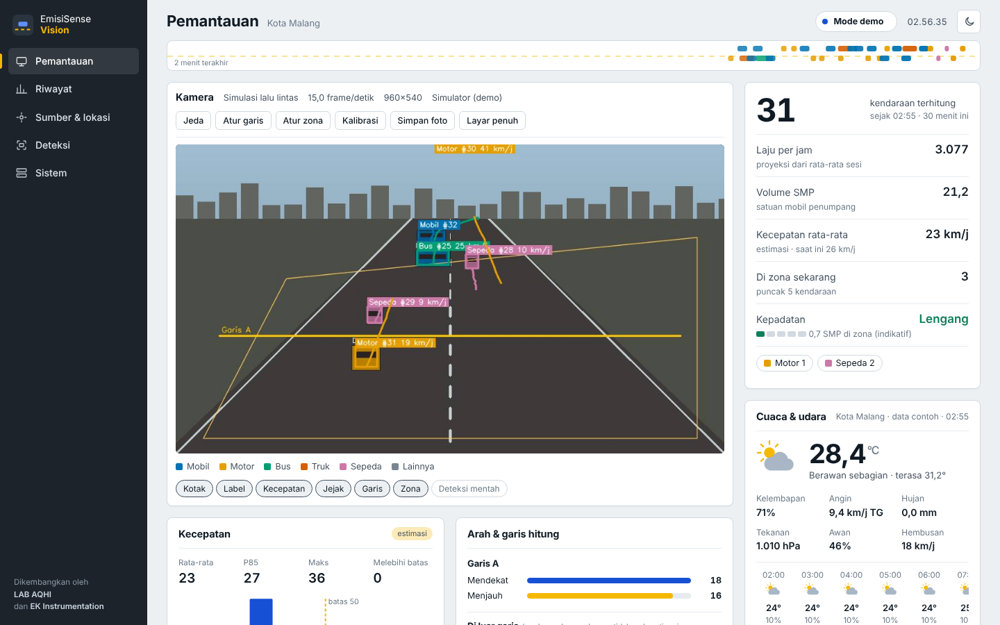

# EmisiSense Vision

Dasbor **visi komputer lalu lintas + cuaca waktu nyata** untuk penelitian *EmisiSense* (PDU 2026, Universitas Brawijaya). Sistem membaca video CCTV, mendeteksi dan melacak kendaraan, mengklasifikasikan jenisnya, memperkirakan kecepatan, menghitung arus per arah, dan menampilkannya bersama cuaca serta kualitas udara dari Open-Meteo dalam satu dasbor web interaktif. Seluruh hasil deteksi disimpan ke database SQLite.



## Sumber CCTV acuan

Sumber bawaan adalah CCTV Kota Malang yang menjadi acuan penelitian:

```
https://cctvmalang.24hour.id/twentyfourhourid/proxy.php?id=767576969564466612969572
```

Tautan ini tersimpan sebagai nilai bawaan (`emisisense_vision/config.py`). Sumber dan lokasi cuaca dapat diganti kapan saja dari dasbor (kartu **Sumber video & lokasi cuaca**); tombol **CCTV Malang (acuan)** mengembalikannya.

## Pemasangan

Prasyarat: Python 3.10+ dan akses internet (untuk memasang paket). Pemasang membuat **lingkungan virtual `.venv` sendiri** di dalam folder proyek, sehingga tidak mengganggu Python sistem.

### Linux (satu baris, clone dari git)

```bash
curl -fsSL https://raw.githubusercontent.com/efendiyhy/computer-vision/main/install.sh | bash
```

Untuk server (jalan otomatis saat boot, firewall `ufw` dibuka bila aktif):

```bash
curl -fsSL https://raw.githubusercontent.com/efendiyhy/computer-vision/main/install.sh | bash -s -- --service
# opsi lain: --dir /opt/emisisense  --port 8080  --password KATASANDI
```

Saat selesai, pemasang mencetak alamat akses jaringan lokal, mis. `http://192.168.1.20:5000`. Kelola layanan: `sudo systemctl status|restart|stop emisisense-vision`, log: `journalctl -u emisisense-vision -f`.

### Windows (PowerShell)

```powershell
irm https://raw.githubusercontent.com/efendiyhy/computer-vision/main/install.ps1 | iex
```

Dengan firewall + mulai otomatis saat login (jalankan PowerShell **sebagai Administrator**):

```powershell
& ([scriptblock]::Create((irm https://raw.githubusercontent.com/efendiyhy/computer-vision/main/install.ps1))) -Firewall -AutoStart
```

Pemasang membuat pintasan **EmisiSense Vision** di Desktop dan mencetak alamat akses jaringan lokal. Jika `irm | iex` diblokir kebijakan eksekusi: `powershell -ExecutionPolicy Bypass -File install.ps1`.

### Manual (buat env sendiri dulu)

```bash
git clone https://github.com/efendiyhy/computer-vision.git
cd computer-vision
python3 -m venv .venv                  # Windows: py -3 -m venv .venv
source .venv/bin/activate              # Windows: .venv\Scripts\activate
pip install -r requirements.txt
python run.py
```

Pakai conda? `conda create -n emisisense python=3.11 && conda activate emisisense && pip install -r requirements.txt`.

### Memperbarui

Data (`data/`) dan pengaturan (`config.json`) tidak pernah tersentuh pembaruan. Ada tiga cara:

1. **Dari web:** menu **Sistem → Versi & pembaruan**. Aplikasi memeriksa GitHub, menampilkan daftar perubahan, lalu tombol **Perbarui dan mulai ulang** menarik kode, memasang dependensi bila berubah, dan memulai ulang sendiri. Lencana merah muncul di menu bila ada versi baru.
2. **Dari terminal:** `./update.sh` (Linux) atau `update.bat` (Windows). Skrip ini juga memulai ulang layanan systemd `emisisense` bila ada.
3. **Manual:** `git pull --ff-only` lalu `.venv/bin/pip install -r requirements.txt`.

Pembaruan ditolak bila ada perubahan lokal pada berkas kode (agar tidak menimpa suntingan Anda); simpan dulu dengan `git stash`.

## Menjalankan

```bash
./run.sh            # Linux/macOS      (Windows: run.bat)
python run.py                         # CCTV acuan, dasbor di port 5000
python run.py --demo                  # simulasi lalu lintas tanpa CCTV
python run.py --source video.mp4      # berkas / URL / rtsp:// / 0 (kamera USB)
python run.py --port 8080 --password KATASANDI
python run.py --local                 # hanya dari komputer ini
```

Saat dijalankan, server **menampilkan alamat IP jaringan lokal** (dan menampilkannya juga di footer dasbor), sehingga dasbor bisa dibuka dari laptop/HP lain di jaringan yang sama:

```
  Buka dari perangkat mana pun di jaringan yang sama:
     http://192.168.1.20:5000
     http://localhost:5000
```

Bawaannya mendengarkan di semua antarmuka (`0.0.0.0`). Di jaringan bersama, pakai `--password` (atau variabel `EMISISENSE_PASSWORD`); pengaturan dasbor dapat diubah oleh siapa pun yang bisa mengaksesnya. Bila tidak terjangkau dari perangkat lain, periksa firewall server (port 5000/TCP).

## Fitur

| Fitur | Keterangan |
|---|---|
| Video lancar | Tiga utas terpisah (baca, deteksi, kirim): video tetap mulus walau deteksi lambat. Kotak kendaraan diprediksi bergerak di antara hasil deteksi. |
| Deteksi & jenis | MobileNet-SSD pada frame penuh, zona diperbesar atau ubin (presisi Cepat/Seimbang/Teliti), ditambah pencarian di area yang bergerak. Objek bergerak yang tidak dikenali dihitung sebagai **Lainnya**. YOLO opsional (juga mengenali truk). |
| Pelacakan | Kalman berbasis detik + Hungarian, jendela asosiasi adaptif; dirancang untuk CCTV 2 sampai 5 fps. |
| Hitung & arah | **Satu garis = satu arah.** Garis hanya menghitung kendaraan yang lewat searah panah di garis (tiga panah terlihat jelas di video); tombol **Balik arah panah** membalik arahnya. Jalan dua arah memakai dua garis berlawanan. Tiap garis punya warna sendiri, berbeda dari zona (cyan). Kendaraan yang lewat berlawanan panah tidak dihitung; kendaraan yang bergerak tanpa menyentuh garis mana pun tetap terhitung di baris **Di luar garis** (matikan dengan `count_outside: false` di config). Konfigurasi lama (dua arah per garis) otomatis dipecah menjadi dua garis. Semua garis boleh dihapus: tanpa garis tidak ada kendaraan yang dihitung. Tambah garis dan ubah nama/arah lewat popup yang hanya tertutup dengan tombol X (Sumber, Lokasi, dan Kalibrasi juga berupa popup). |
| Arah angin & mawar angin | Kartu cuaca menampilkan kompas dan arah angin dalam 16 mata angin (U, UTL, TL, ... UBL) beserta derajatnya. **Mawar angin** (24 jam, 7 hari, 30 hari) di Pemantauan dan Riwayat menunjukkan dari arah mana angin datang dan seberapa sering, per kelas kecepatan. Riwayat 30 hari diambil dari Open-Meteo saat aplikasi berjalan. CSV memuat `arah_angin_derajat` dan `arah_mata_angin`. API: `/api/windrose?hours=168`. |
| Pejalan kaki | Manusia yang berjalan ikut dideteksi, dilacak, dan dihitung memakai garis yang sama. **Dicatat terpisah** dari kendaraan (kolom `person` di database dan CSV; tidak masuk jumlah kendaraan, SMP, atau statistik kecepatan). Pengendara motor dan sepeda tidak dihitung sebagai pejalan kaki. Bisa diaktifkan/dinonaktifkan dari tombol **Pejalan kaki** di bawah video atau menu Deteksi (`count_people`). |
| Watermark | `ek-instrumentation.com` tertanam di bagian bawah video (tayangan, foto, dan rekaman); tulisan itu juga tautan ke situsnya di halaman web, begitu pula teks pengembang. |
| Rekam video | Tombol **Rekam** menyimpan video ke `data/recordings/` (MP4, 12 fps, cap waktu, watermark; opsional dengan kotak/garis/zona). Dipotong tiap 10 menit dan berhenti otomatis bila ruang disk kurang dari 300 MB. Daftar, putar, unduh, dan hapus ada di **Riwayat**. Dengan `ffmpeg` terpasang (disarankan: `sudo apt install ffmpeg`) rekaman H.264 bisa diputar di browser; tanpa ffmpeg memakai MP4V (hanya untuk diunduh). Pengaturan: `record_fps`, `record_segment_min`, `record_min_free_mb`, `record_overlay`. |
| Antarmuka | Menu samping bisa diminimalkan (tombol panah di tepinya; pilihan diingat), dengan logo baru. |
| Zona pengamatan | Seret titik biru di video; kepadatan dihitung dan deteksi difokuskan di zona. Petunjuk editor tampil di bawah video, bukan di atasnya. |
| Kecepatan | Skala otomatis dari ukuran khas jenis, atau **kalibrasi manual**. **Hanya estimasi.** |
| Cuaca & udara | Open-Meteo: suhu, kelembapan, angin, hujan, prakiraan, US AQI, PM2,5, PM10, NO₂, CO, SO₂, O₃. |
| Sumber & lokasi | Ganti sumber video (URL, HLS, MJPEG, JPEG, RTSP, **tautan YouTube**, berkas, kamera USB) dengan **Tes koneksi** yang melaporkan jenis, resolusi, dan fps nyata; ganti lokasi cuaca. |
| Diagnosa | Menu Sistem menampilkan fps masuk/keluar, waktu per deteksi, objek mentah dan objek gerak. Banner di Pemantauan menjelaskan bila video tidak tersambung, terlalu lambat dari sumbernya, atau belum ada hitungan. |
| Data tersimpan | Lihat di bawah. |

### Panduan garis, zona, dan kalibrasi

Langkah rinci dengan tangkapan layar, cara memilih panjang acuan, validasi, dan lembar catatan: [docs/panduan-kalibrasi.pdf](docs/panduan-kalibrasi.pdf).

### Tautan YouTube

Tempel tautan `youtube.com/watch?...` atau `youtu.be/...` di **Sumber & lokasi**. Aplikasi memakai `yt-dlp` untuk mendapatkan aliran langsungnya dan menyegarkannya otomatis (video biasa diputar berulang, siaran langsung diikuti). Bila gagal: perbarui `yt-dlp` (`.venv/bin/pip install -U yt-dlp`), atau unduh videonya lalu unggah berkasnya. YouTube kadang menolak permintaan dari IP server.

### Bila video lambat atau tidak ada hitungan

- **Lambat:** lihat *Frame masuk* di menu Sistem. Bila di bawah 3 fps, kamera/server CCTV-nya yang lambat; aplikasi tetap melacak, kecepatan kendaraan kurang teliti. Bila *Waktu per deteksi* tinggi, turunkan *Lebar frame proses* atau pilih presisi **Cepat** di menu Deteksi.
- **Tidak ada hitungan:** pastikan zona menutupi badan jalan dan garis melintang di jalur kendaraan; turunkan ambang keyakinan (0,25 sampai 0,3); aktifkan *Bantu dengan deteksi gerak*; nyalakan *Deteksi mentah* di bawah video untuk melihat apa yang ditemukan model.

## Penyimpanan data

Semua data ditulis otomatis ke `data/emisisense.db` (SQLite, mode WAL; mode `--demo` memakai `emisisense_demo.db` sehingga data demo tidak bercampur):

| Tabel | Isi |
|---|---|
| `events` | satu baris per kendaraan yang melintasi garis: waktu, ID, jenis, garis, arah, kecepatan, sumber video |
| `minutes` | agregat per menit: jumlah per jenis, total, SMP, kecepatan rata-rata, plus suhu, RH, hujan, angin, PM2.5, PM10, CO, NO₂, US AQI pada menit itu |
| `weather` | rekaman cuaca & kualitas udara tiap pembaruan Open-Meteo (dengan koordinat dan nama lokasi) |

- Kejadian ditulis langsung; agregat menit di-flush tiap beberapa detik dan saat aplikasi berhenti (Ctrl+C / `systemctl stop`). Bila aplikasi dihidupkan ulang pada menit yang sama, hitungan **dilanjutkan**, bukan ditimpa.
- Setiap menit yang diamati tercatat, termasuk yang berisi 0 kendaraan. Menit yang tidak ada barisnya berarti sistem tidak berjalan atau tidak ada frame.
- Tombol **Reset tampilan hitungan** hanya mengosongkan angka di layar; data di database tidak dihapus.
- Dari dasbor (kartu *Data tersimpan*): unduh CSV kejadian, per menit, cuaca & udara dengan rentang tanggal, atau salin seluruh database (`.db`). Grafik *Riwayat tersimpan* menampilkan 6 jam sampai 30 hari.
- Cadangkan cukup dengan menyalin folder `data/`. Untuk analisis: `sqlite3 data/emisisense.db "select * from minutes limit 10"` atau buka CSV di Excel/Python.

## Detektor YOLO (opsional)

```bash
.venv/bin/pip install ultralytics      # Windows: .venv\Scripts\pip install ultralytics
```
Lalu pilih **YOLO** di Pengaturan (bobot `yolov8n.pt` terunduh otomatis saat pertama dipakai). Lebih akurat dan mengenali truk, tetapi lebih berat.

## Struktur

```
install.sh / install.ps1    # pemasang Linux / Windows (clone git + .venv)
update.sh / update.bat      # pembaruan dari GitHub
run.py  run.sh  run.bat     # peluncur
emisisense_vision/
  config.py                 # konfigurasi + tautan CCTV acuan
  reader.py                 # pembaca sumber (HLS, MJPEG, JPEG, RTSP, berkas) + tes koneksi
  detector.py  tracker.py   # SSD / gerak / YOLO ; Kalman + Hungarian
  updater.py                # periksa dan pasang pembaruan dari git
  analytics.py              # hitung, kecepatan, kepadatan
  storage.py                # SQLite: events, minutes, weather + ekspor CSV
  weather.py                # Open-Meteo (cuaca + kualitas udara)
  pipeline.py  simulator.py # video -> deteksi -> overlay MJPEG ; mode demo
  server.py  netinfo.py     # Flask + API ; alamat IP jaringan lokal
  web/                      # index.html, app.css, app.js (tanpa CDN)
models/  legacy/  tests/    # model SSD ; skrip awal ; pytest
```

API ringkas: `GET /api/state`, `GET /api/stream` (SSE), `GET|POST /api/config`, `POST /api/source/test`, `GET /api/geocode?q=`, `GET /api/history?hours=24`, `GET /api/storage`, `GET /api/update/check`, `POST /api/update/apply`, `POST /api/pause`, `GET /api/export/{events,minutes,weather}.csv?from=YYYY-MM-DD&to=YYYY-MM-DD`, `GET /api/export/database`.

## Catatan keterbatasan

- Kecepatan dan SMP adalah **perkiraan**; untuk pelaporan, kalibrasi dengan jarak nyata di lokasi dan validasi dengan pengukuran lapangan.
- Akurasi bergantung pada sudut kamera, resolusi, dan cahaya; MobileNet-SSD kurang baik untuk kendaraan sangat kecil atau terhalang.
- Peningkatan akurasi: pakai YOLO, naikkan presisi, sempitkan zona pada badan jalan.
- Uji: `pip install pytest && pytest`.

---
Dikembangkan oleh **LAB AQHI** dan **EK Instrumentation**.
Model MobileNet-SSD mengikuti lisensi sumber aslinya (chuanqi305/MobileNet-SSD).

## Aplikasi Android

Aplikasi Android membungkus dashboard web agar terasa seperti aplikasi asli: layar pertama hanya meminta IP, lalu langsung masuk. Navigasi tab di bawah, popup berupa lembar bawah, tarik untuk menyegarkan, layar tetap menyala, unduhan lewat pengelola unduhan, dan tombol Kembali mengikuti riwayat halaman.

- **Unduh APK**: halaman *Releases* di GitHub (rilis `android-latest`, selalu versi terbaru), atau *Actions → Android APK → Artifacts*.
- **Pasang**: buka berkas APK di ponsel, izinkan pemasangan dari sumber ini. APK ini bertanda tangan debug (belum untuk Play Store).
- **Pakai**: pastikan ponsel satu jaringan dengan Orange Pi, ketik IP (mis. `192.168.1.20`; port 5000 otomatis), tekan *Hubungkan*. Bila server memakai `--password`, kolom kata sandi akan muncul. Ganti server lewat *Sistem → Akses & kredit → Ganti server*.
- **Build**: dikerjakan otomatis oleh `.github/workflows/android.yml`. Lokal: `cd android && gradle assembleDebug`.

## Hotspot Orange Pi (tanpa router)

Orange Pi dapat memancarkan Wi-Fi sendiri sehingga ponsel/laptop langsung tersambung tanpa router. Dari web (Sistem → Jaringan Orange Pi) Anda memilih: tetap memakai hotspot, atau menyambungkan Orange Pi ke Wi-Fi lain. Bila Wi-Fi pilihan gagal tersambung, hotspot otomatis menyala kembali.

Pasang (di Orange Pi, butuh NetworkManager, bawaan Armbian/Orange Pi OS):

```bash
cd ~/emisisense-vision && git pull && sudo ./hotspot/install-hotspot.sh
# opsional: sudo ./hotspot/install-hotspot.sh --ssid LabAQHI --password rahasia123
```

- Bawaan: SSID `EmisiSense-XXXX` (4 karakter MAC), sandi `emisisense123`, alamat `http://10.42.0.1:5000`, SSH `orangepi@10.42.0.1`.
- Saat hotspot menyala Orange Pi tidak memakai Wi-Fi lain (satu adaptor), tetapi kabel LAN tetap bisa dipakai sebagai internet.
- Tanpa internet, jam Orange Pi dikoreksi otomatis dari ponsel/browser yang terhubung. Semua waktu memakai WIB (GMT+7).
- Aplikasi Android: tombol “Pakai hotspot Orange Pi” mengisi 10.42.0.1 dan mengikat aplikasi ke Wi-Fi agar tidak dialihkan ke data seluler.
- CLI: `sudo emisisense-net status|scan|hotspot|boot`, `echo '{"ssid":"NAMA","password":"SANDI"}' | sudo emisisense-net connect`.

## Sensor PM & gas lokal (ESP32) dan sinkronisasi data

Kode penerima dari proyek [pmgas-merge](https://github.com/efendiyhy/pmgas-merge) sudah dilebur ke sini. Dua ESP32 (PM dan Gas) mengirim ke
`http://IP-ORANGE-PI:8787/api/ingest` (port bawaan firmware; ubah dengan `--sensor-port`, `0` = nonaktif). Di dashboard tiap ESP32 isi
**Laptop Server** dengan IP Orange Pi saja (hotspot: `10.42.0.1`). Token opsional lewat variabel lingkungan `ESP_LAN_TOKEN` (header `X-Device-Token`).
Data open-meteo tetap ada sebagai pembanding.

Tampilan memakai menu yang sudah ada: nilai dan grafik 30 menit di **Pemantauan**, grafik partikulat/gas di **Riwayat**, status alat, alamat penerima,
nama sesi dan label di **Sistem**. Data disimpan di `data/pmgas.db`.

**Pengisian data kosong.** PM dan Gas digabung menurut waktu ukur sensor (per detik). Nilai yang hilang diisi dengan nilai valid terakhir sebelumnya,
paling lama 300 detik (dapat diubah di panel Unduh, `0` = tidak diisi); kolom yang diisi tercatat di `filled_columns`.

**Unduh data** (panel Unduh di Riwayat): semua unduhan punya pilihan **tanggal dan jam** (Dari/Sampai, WIB) dan berupa ZIP berisi CSV + `KETERANGAN.txt`
(data apa itu, rentang, jumlah baris, catatan pengolahan, arti dan satuan kolom). Pilihan:

| Unduhan | Isi |
|---|---|
| Kendaraan + PM & gas per menit | Dokumen sinkron: hitungan vision per menit + rata-rata PM/gas per menit + cuaca Open-Meteo |
| PM & gas per detik (sudah diisi) | Gabungan PM+Gas menurut waktu ukur, data kosong diisi |
| PM & gas data mentah | Setiap paket ESP32 apa adanya |
| Agregat lalu lintas per menit, Kejadian lintas, Cuaca & udara, Seluruh database | Data yang sudah ada sebelumnya |

API: `/api/export/{sinkron-kendaraan-pmgas,pmgas-gabungan,pmgas-mentah,minutes,events,weather,database}.zip?from=2026-11-20T08:00&to=2026-11-20T09:30&gap=300`.

## Sinkronisasi cuaca (data direkam offline)

Bila kendaraan direkam tanpa internet, kolom cuaca dan kualitas udara pada catatan menit dibiarkan kosong (tidak diisi nilai lama).
Setelah Orange Pi online, tekan tombol **Sinkronisasi** di bagian atas dashboard: data per jam Open-Meteo (suhu, kelembapan, hujan, angin,
PM2,5, dll.) diunduh dan diisikan ke menit yang masih kosong; data waktu nyata tidak ditimpa. Batas riwayat Open-Meteo lewat `past_days` adalah 92 hari.
Menit yang diisi lewat sinkronisasi ditandai `cuaca_sinkron=1` pada ekspor CSV. API: `GET /api/sync` (status), `POST /api/sync` (jalankan).

Panel **Jaringan Orange Pi** di halaman Sistem selalu tampil; bila pengatur jaringan belum terpasang, panel menampilkan perintah pemasangan
(`sudo ./hotspot/install-hotspot.sh`). `./update.sh` juga mengingatkan bila pengatur ini belum terpasang.

## Memakai video untuk program lain

Kamera hanya bisa dibuka satu program. Biarkan dashboard memegang kamera, lalu program lain membaca videonya lewat jaringan (tanpa garis/kotak/watermark):

| Alamat | Isi |
|---|---|
| `http://IP:5000/video/raw` | aliran MJPEG bersih (`?fps=1..30`, bawaan 10) |
| `http://IP:5000/snapshot/raw.jpg` | satu gambar JPEG terbaru |
| `http://IP:5000/video` | aliran dengan garis & deteksi |

Di Orange Pi sendiri pakai `127.0.0.1` sebagai IP. Contoh Python: `cv2.VideoCapture("http://127.0.0.1:5000/video/raw")`. Bila dashboard memakai `--password`, sertakan: `http://:KATA@127.0.0.1:5000/video/raw`.
